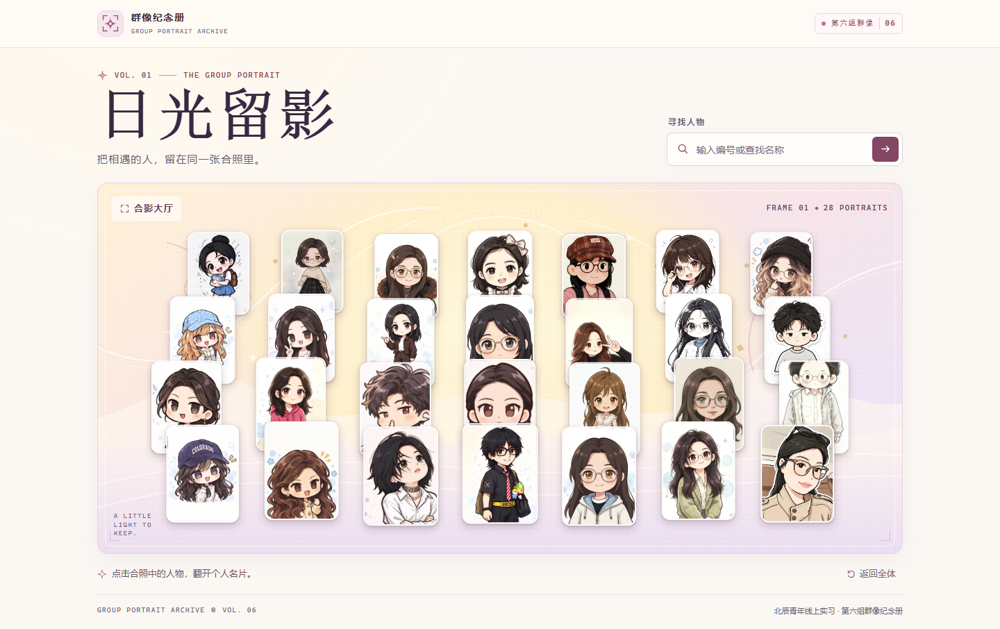

# 群像纪念册 · 日光留影

北辰青年线上实习 · 第六组的 28 人群像。桌面四排，从后往前各 7、7、7、7 人。手机五排，从后往前各 6、6、6、5、5 人。合影卡片只展示形象。点击卡片可以打开个人资料，也可以按编号或查找名称搜索。选中卡片会显示白边和光晕，其他人物会变暗。访问 `/?member=014` 可以直达对应名片，地址栏会随选中的人物更新。点舞台空白处、关闭资料或按 Esc 可以取消选择。清空搜索和「返回全体」会恢复整张合照。



协作者从 [协作指南](CONTRIBUTING.md) 开始。Agent 先读 [AGENTS.md](AGENTS.md)，再用 [项目结构与修改指南](docs/项目结构与修改指南.md) 查功能入口、可改项和预期效果。

## 本地运行

首次下载后，在项目目录使用 [.node-version](.node-version) 中的 Node.js 24.16.0，并用 `npm ci` 按 [依赖锁文件](package-lock.json) 安装。页面与图片都来自仓库。

```bash
git clone https://github.com/fushuyiliu/group-portrait-archive.git
cd group-portrait-archive
npm ci --cache .npm-cache
npm run dev -- --port 3218
```

要查看最早的 26 人测试版，可单独切换到 `v0.1.0` 标签。准备贡献时，按 [协作指南](CONTRIBUTING.md) 从最新 `main` 开任务分支。Windows PowerShell 若限制 npm 脚本执行，可把命令中的 `npm` 替换成 `npm.cmd`。

浏览器打开 [本地预览](http://127.0.0.1:3218/)，按 Ctrl+C 可停止预览。桌面用 1440 × 900，手机用 390 × 844，等人物加载后与 [基线截图](#自测与截图) 对照。页面使用系统字体，系统差异会影响文字字形。

## 浏览器测试

在项目目录运行以下命令。测试会在端口 3219 临时启动生产构建，逐个点选 28 位成员，并验证搜索、连续切换和名片直达链接。

```bash
npm run typecheck
npm run build
npx playwright install chromium
npm run test:browser
```

Linux 若缺少 Chromium 系统依赖，可使用 `npx playwright install --with-deps chromium`。如需把浏览器下载留在项目目录，在安装和测试前将 `PLAYWRIGHT_BROWSERS_PATH` 设为 `0`。PowerShell 可用 `$env:PLAYWRIGHT_BROWSERS_PATH = '0'`，Bash 可用 `export PLAYWRIGHT_BROWSERS_PATH=0`。

## 人物和素材

| 路径 | 用途 |
| --- | --- |
| `data/members.ts` | 28 位成员的编号、化名、图片地址和资料（个人特质 / 团队价值 / 记忆点） |
| `data/portrait-layout.ts` | 桌面与手机各排的槽位顺序、横向范围和卡片中心位置 |
| `public/assets/members/` | 28 张合影用 WebP 画像 |
| `public/assets/profiles/` | 资料面板使用的方形 WebP 头像，文件名与合影画像对应 |
| `public/light-cones/member-018/` | 分享鲍的可旋转光锥样卡，通过 `/?member=018` 查看 |
| `public/assets/backgrounds/` | 大厅使用的原创背景 |
| `components/portrait-hall.tsx` | 合影、搜索和资料名片 |
| `app/globals.css` | 桌面侧栏、移动底部面板、层级和动效 |

两个布局按行生成 `position` 和 `mobilePosition`。坐标用舞台宽高的百分比表示，锚定在卡片中心，`scale` 决定大小（前排更大），`layer` 决定初始图层。交互通过稳定的 `memberId` 关联。查找示例为 `001`（稳稳子）、`028`（冒泡喜）。

## 自测与截图

自测记录见 [阶段一自测](docs/阶段一自测.md)。以下为本地浏览器实际截图。

- [桌面合影](docs/screenshots/desktop.png)
- [桌面名片](docs/screenshots/desktop-profile.png)
- [手机合影](docs/screenshots/mobile.png)
- [手机名片](docs/screenshots/mobile-profile.png)

## 后续补充画像

1. 确认画像可公开后，把展示图裁成约 3:4 的竖幅，存为 `public/assets/members/member-0NN.webp`。
2. 单独裁出保留完整头部的方形头像，存为 `public/assets/profiles/member-0NN.webp`。
3. 更新 `data/members.ts` 中对应成员的 `avatar` 路径。
4. 本地 `npm run dev` 确认形象、搜索和资料名片正常后，按协作指南提交。
